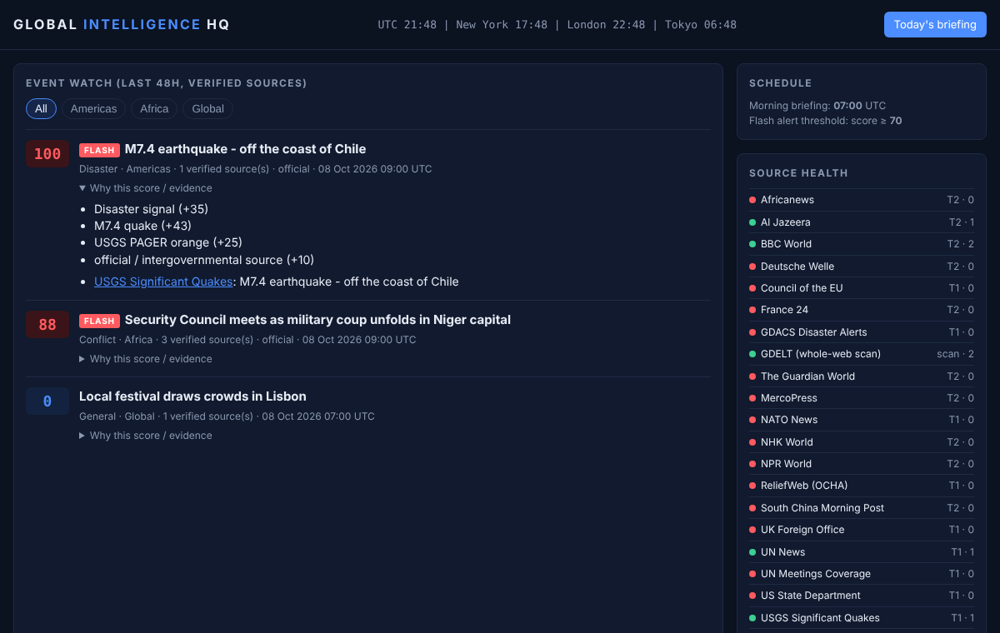
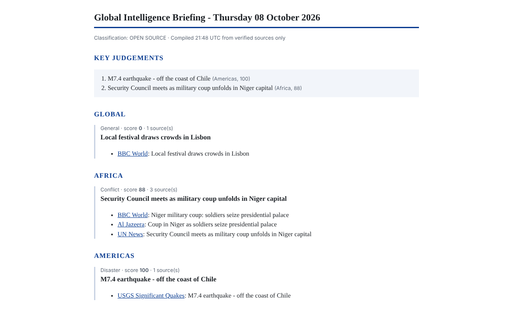

# Global Intelligence HQ

A self-hosted watch floor for world events. It sweeps verified news and official feeds every few minutes, scans the open web for early signals, groups reports into events, scores how globally significant each one is, sends a **FLASH alert** the moment something crosses the threshold, and delivers a **morning intelligence briefing** at a set time.



## Architecture plan

### 1. Evidence model: "skim everything, believe only verified"
| Layer | What it is | Role |
|---|---|---|
| **Tier 1, official** | UN News, UN Meetings Coverage, WHO outbreak news, ReliefWeb (OCHA), GDACS disaster alerts, USGS earthquakes, US State Dept, UK FCDO, NATO, Council of the EU | Evidence. Presence adds +10 and is enough on its own to trigger an alert. |
| **Tier 2, newsrooms** | BBC World, Al Jazeera, Guardian, France 24, DW, NPR, NHK World, SCMP, Africanews, MercoPress | Evidence. Alerts need at least 2 independent sources unless a Tier 1 source confirms. |
| **Discovery** | GDELT (scans news sites in 100+ languages worldwide, updated every 15 min) | Attention signal only. It can raise the score of an event verified sources already report, but **can never create or confirm an event**. |

All sources live in [`sources.json`](sources.json); adding one is a single line. Reuters and AP no longer publish public RSS; adding them means a paid licence (Reuters Connect, AP Media API), which the ingestion layer is ready for.

### 2. Ingestion
Every `poll_minutes` (default 5) all feeds are fetched in parallel (RSS, Atom, RDF, USGS GeoJSON, GDELT JSON). Each item is stored once in SQLite, keyed by URL. A failing feed is recorded in **Source health** and never stops the sweep.

### 3. Event clustering
Reports from the last 48 hours are grouped into events by shared key terms in their headlines, so "Niger military coup" from the BBC, Al Jazeera and UN News becomes one event with three independent sources. The headline shown is the official source's when there is one.

### 4. Significance scoring (0 to 100)
| Signal | Points |
|---|---|
| Category signal (nuclear 55, coup / invasion 50, strikes 40, outbreak 40, disaster 35, diplomacy 30, ...) | up to 55 |
| Reported casualties (log scale) | up to 25 |
| Earthquake magnitude above 6, USGS PAGER orange or red | up to 40 + 25 |
| Each extra independent verified source | +8 (max 24) |
| Official / intergovernmental source present | +10 |
| Matching volume across the open web (GDELT) | up to 10 |

Every event shows its score breakdown ("why this score") and links to each piece of evidence, so a judgement can always be checked.

### 5. Delivery
* **FLASH alerts**: sent once per event when `score >= threshold` (default 70) and it is corroborated (2+ sources or 1 official). Score 85+ is sent as urgent.
* **Morning briefing**: at `briefing.time` in `briefing.timezone`, once per day. Key judgements (top 5), then events by region with evidence links. Also viewable any time at `/briefing`. Copies are saved in `briefings/`.
* **Channels** (any combination): `ntfy` (free push notifications to a phone via the ntfy app), `email` (any SMTP account), `webhook` (Slack, Discord, Teams, etc.), `console`.



### 6. Roadmap
1. Add an AI analyst pass that writes the briefing's key judgements as prose and catches events the keyword scorer misses.
2. Expand sources: more regional official feeds, ministries of foreign affairs, licensed wire services.
3. Map view, topic watchlists (for example "only alert me on Taiwan Strait and Sahel"), and a searchable archive.

## Running it
Needs only Python 3.9+; no packages to install.

```bash
cp config.example.json config.json   # set briefing time/timezone, ntfy topic or email
python3 -m hq            # run the watch: sweeps, alerts, briefing, dashboard on http://localhost:8080
python3 -m hq once       # one sweep, then exit
python3 -m hq briefing   # print today's briefing
python3 -m unittest      # offline end-to-end test
```

For phone alerts: install the **ntfy** app, subscribe to a long random topic name, and put the same name in `config.json`. For email with Gmail, create an app password and export it as `HQ_SMTP_PASSWORD`.

## Hosting for free on GitHub
The included workflow (`.github/workflows/watch.yml`) runs the watch on GitHub Actions every 5 minutes and publishes the dashboard to GitHub Pages, so nothing has to run on your own computer.

1. Push this project to a **public** GitHub repository (Actions minutes are unlimited for public repos; a private repo would use up the free allowance within days at a 5-minute interval).
2. Settings > Pages > Source: **GitHub Actions**.
3. Settings > Secrets and variables > Actions: add the secret `HQ_NTFY_TOPIC`, and the variables `HQ_BRIEFING_TIME` and `HQ_BRIEFING_TZ`.
4. Actions tab > Global HQ watch > **Run workflow** once to start it.

GitHub can run scheduled jobs a few minutes late at busy times, and it pauses schedules in repositories with no commits for 60 days. For alerts to the exact minute, run `python3 -m hq` on any always-on machine instead.
